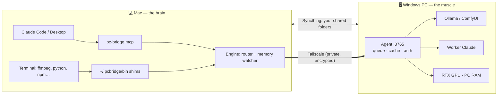
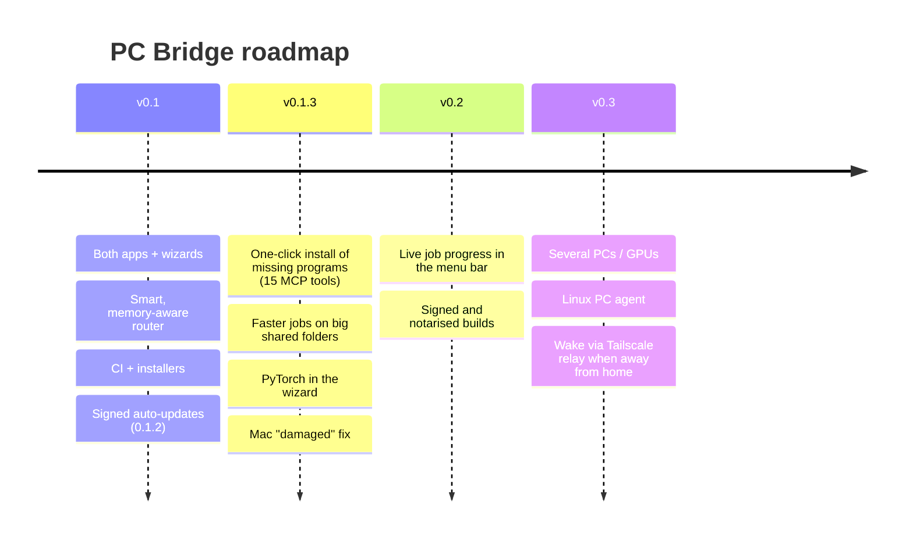

<div align="center">

# ⇄ PC Bridge

**Let Claude on your Mac send heavy work to your Windows PC's GPU and RAM automatically. Results come back to the same folder.**

[](https://github.com/walidriachy/pc-gpu-bridge/actions/workflows/ci.yml)
[](https://github.com/walidriachy/pc-gpu-bridge/releases/latest)
[](LICENSE)


[**Download**](https://github.com/walidriachy/pc-gpu-bridge/releases/latest) ·
[**Beginner guide**](docs/GUIDE.md) ·
[Usage](docs/USAGE.md) ·
[Architecture](docs/ARCHITECTURE.md) ·
[Roadmap](ROADMAP.md) ·
[Contributing](CONTRIBUTING.md)

</div>

---

You work with Claude on your MacBook. Your desktop PC has an RTX graphics card and plenty of RAM that sit idle. **PC Bridge connects them.** When Claude (or you, in Terminal) starts something heavy, such as a video encode, AI image generation, a GPU Python script, an 8 GB pandas job, a Docker build or a big Next.js test suite, PC Bridge works out whether the PC will finish it sooner. If so, it runs the job there and puts the result back in the folder you're working in. If the PC is off, it wakes it. If it can't reach it, the job runs on the Mac as normal and nothing gets stuck.

It's two desktop apps built from one codebase:

* a **menu bar app on the Mac**
* a **system tray app on Windows**

Both have step-by-step setup wizards, so **you don't need Terminal.**

## Contents

- [Features](#features)
- [How it works](#how-it-works)
- [Quick start](#quick-start)
- [Using it](#using-it)
- [Assumptions](#assumptions)
- [Documentation](#documentation)
- [Building from source](#building-from-source)
- [Project status & roadmap](#project-status--roadmap)
- [Security](#security)
- [Contributing](#contributing) · [License](#license)

## Features

| | |
|---|---|
| 🧠 **Smart router** | Compares the estimated Mac time against the PC time, counting file transfer, queue and wake-up. It learns from every job (SQLite history) |
| 🧮 **Memory-aware** | Watches Mac memory pressure. RAM-heavy jobs, and any heavy job while the Mac is short on memory, go to the PC's memory. Both apps show Mac and PC free RAM side by side |
| 🎬 **NVENC for free** | `libx264`/`libx265` are switched to `h264_nvenc`/`hevc_nvenc` when that's safe |
| 🤖 **15 Claude tools (MCP)** | `pc_run`, `pc_run_task`, `pc_delegate_task`, `pc_docker`, `pc_node_build`, `pc_status`, `pc_install`, `pc_gpu`, `pc_memory`, `pc_route_advice`, `pc_push_file`, `pc_pull_file`, `pc_wake`, `comfy_generate`, `ollama_chat` |
| 🪄 **Transparent shims** | `ffmpeg`, `python`, `blender`… in `~/.pcbridge/bin` redirect on their own. `npm`/`pnpm`/`docker` only in projects that opt in |
| 🧰 **Missing programs, one click away** | If a job needs a program the PC doesn't have (Blender, PyTorch, Node.js…), the result says so and Claude can offer to install it with `pc_install`, after asking you. On the PC, **Settings → Programs** has an **Install** button for each one. Only a fixed list of programs can be installed, in their normal Windows place |
| 👷 **Worker Claude** | Hands whole multi-step tasks to a Claude running next to the GPU |
| 📁 **Automatic file sync** | A private Syncthing setup that the app configures for you. Inputs a command names are pushed directly if they haven't synced yet |
| ⚡ **Result cache & warm models** | The same command on the same inputs reuses the earlier result, and Ollama models stay loaded |
| 🌙 **Wake-on-LAN** | The PC can sleep and wakes up for jobs. The wizard configures the network card for you |
| 🔒 **Private by design** | Tailscale only, one-time pairing code, token in a private file only you can read, one strict root folder on the PC, optional allowlist |
| 🧹 **Self-cleaning** | Job folders are deleted after 14 days, and the cache is capped at 20 GB |
| 🩺 **Diagnostics** | One button checks every part and explains each fix in plain English |

## How it works



1. Claude runs a command, for example `ffmpeg -i clip.mov -c:v libx264 out.mp4`.
2. The engine classifies it (GPU, RAM-heavy or light), checks the Mac's memory and estimates both times.
3. If the PC is the better choice, the engine wakes it if needed, pushes any missing inputs, rewrites paths (and the encoder to NVENC), and streams the job.
4. The output streams back live, the result file lands next to `clip.mov`, and the exit code is the real one.

More diagrams: [docs/ARCHITECTURE.md](docs/ARCHITECTURE.md) covers the life of a job, the routing decision, the folder layout and the security model.

## Quick start

> **Set up the PC first, then the Mac.** It takes about 30 minutes, mostly downloads.

1. **Download** from the [latest release](https://github.com/walidriachy/pc-gpu-bridge/releases/latest):

   | Computer | File |
   |---|---|
   | Windows PC | `PC Bridge Setup.exe` |
   | Mac (Apple Silicon) | `PC Bridge.dmg` |

   *GitHub may save these as `PC.Bridge.Setup.exe` and `PC.Bridge.dmg`; they're the same files.*

2. **PC:** run the installer. If you see *"Windows protected your PC"*, click **More info → Run anyway**. Then follow the 9-step wizard. It ends by showing a **6-digit code**.
3. **Mac:** drag the app to Applications and open it from there. The first time, macOS says it can't check the app: click **Done**, then go to **System Settings → Privacy & Security** and click **Open Anyway**. Follow the 8-step wizard and type the code.
4. Restart Claude Desktop. **Done:** just ask Claude to do heavy things.

Full walkthrough, with what every step does and how to fix any ❌: **[docs/GUIDE.md](docs/GUIDE.md)**

## Using it

```text
You:    "Convert all the .mov files in Videos/ to 1080p MP4"
Claude: runs ffmpeg → "[PC Bridge] sending …/clip.mov to the PC…" → the MP4s appear in Videos/
```

```bash
pc-bridge run -- python train.py          # force any command onto the PC
PCBRIDGE_LOCAL=1 ffmpeg -i a.mov b.mp4    # force it to stay on the Mac
echo 'offload = ["npm","docker"]' > .pcbridge   # let this project's builds/tests use the PC
pc-bridge doctor                          # health check
```

All the tools, settings and environment variables are in **[docs/USAGE.md](docs/USAGE.md)**.

> **About memory:** apps open on your Mac (browser, editors, Claude) always use the Mac's RAM. PC Bridge doesn't add RAM to your Mac. It moves heavy jobs to the PC, where they use the PC's RAM.

## Assumptions

These are the choices this build makes. Each one is something you can change later.

1. **Hardware:** a MacBook with Apple Silicon (built on an M1 Pro) and a Windows 10/11 PC with an NVIDIA RTX card (built for an RTX 3090 with 24 GB VRAM and 32 GB RAM), preferably on wired Ethernet.
2. **Only an Apple Silicon DMG is built.** Intel Macs aren't targeted.
3. **Tailscale is the only network path.** On the PC, the agent listens only on `127.0.0.1` and the Tailscale IP. Both computers sign in to the same (free) Tailscale account.
4. **One root folder on the PC:** `D:\PCBridge`, or `C:\PCBridge` if there's no D: drive. You can change it in wizard step 1. Nothing outside it is read or written.
5. **Files move with Syncthing**, which the app configures for the folders you choose. A file named in a command is also pushed directly if it hasn't synced yet.
6. **One job at a time** on the PC by default, first come, first served. That avoids running out of VRAM.
7. **The worker Claude** uses your own Claude login on the PC, and its edits are limited to `PCBridge\worker`. This step is optional.
8. **The apps aren't signed with a paid certificate** (that costs a yearly fee), so macOS and Windows warn the first time. The Mac app has a free "ad-hoc" signature, so macOS offers **Open Anyway** instead of calling it damaged. The guide shows the one-time click.
9. **No admin rights day to day.** Windows asks for admin once, during setup, for Wake-on-LAN and power settings. The agent is a normal process that starts with Windows, not a service.
10. **Node and Docker offload is opt-in per project** with a `.pcbridge` file, because their dependencies must also be installed on the PC.
11. **Housekeeping:** job folders are deleted after 14 days and the result cache is capped at 20 GB.

## Documentation

| Document | For |
|---|---|
| [docs/GUIDE.md](docs/GUIDE.md) | Beginners: install, both wizards screen by screen, unsigned-app warnings, troubleshooting |
| [docs/USAGE.md](docs/USAGE.md) | Everyday use: what to ask Claude, CLI, MCP tools, `.pcbridge`, every setting |
| [docs/ARCHITECTURE.md](docs/ARCHITECTURE.md) | How it works inside, with diagrams |
| [ROADMAP.md](ROADMAP.md) | What's done, what's next, decisions, known limitations |
| [CHANGELOG.md](CHANGELOG.md) | Release notes |
| [CONTRIBUTING.md](CONTRIBUTING.md) | Development setup, tests, conventions |
| [SECURITY.md](SECURITY.md) | Security model and how to report a vulnerability |

## Building from source

**Requirements:** Rust (stable), Node 20+, Python 3.11+. Building the Windows installer requires Windows.

```bash
git clone https://github.com/walidriachy/pc-gpu-bridge && cd pc-gpu-bridge

# PC agent (Python)
python3 -m venv agent/.venv && agent/.venv/bin/pip install -e "agent[dev]"
(cd agent && .venv/bin/ruff check . && .venv/bin/python -m pytest -q)

# UI (the Rust app embeds the built UI, so build it first)
(cd app && npm ci && npm run lint && npm test && npm run build)

# Rust core + desktop app
cargo clippy --workspace --all-targets -- -D warnings
cargo test --workspace
bash scripts/e2e-real-agent.sh                 # real Python agent ⇄ Rust engine

# Run / package
(cd app && npx tauri dev)
(cd app && npx tauri build --bundles dmg)      # Mac   → target/release/bundle/dmg/
(cd app && npx tauri build --bundles nsis)     # Windows → target/release/bundle/nsis/
```

| Path | What |
|---|---|
| `agent/` | Python FastAPI agent that runs on the PC |
| `crates/bridge-core/` | Shared Rust logic: router, detection, path mapping, MCP, shims, agent client |
| `app/src/` | React + TypeScript UI (wizards, Status, Jobs, Settings, Help) |
| `app/src-tauri/` | Tauri v2 backend: Mac and Windows system actions, tray, CLI modes |
| `scripts/` | End-to-end test script |
| `.github/workflows/` | CI (Linux, macOS, Windows) and the release pipeline |

**CI** runs the Python tests and ruff, the UI lint and tests, Rust fmt, clippy and tests, the real-agent end-to-end test, and installer builds on macOS and Windows. **Releases:** pushing a `v*` tag builds `PC Bridge.dmg` and `PC Bridge Setup.exe` and attaches them to the GitHub release.

## Project status & roadmap

**v0.1.x.** Every feature above is implemented and tested in CI (more than 150 automated tests across Python, Rust and TypeScript). What's new since the last release is listed under *Unreleased* in the [changelog](CHANGELOG.md). The Windows code paths have been built and unit-tested in CI but not yet used on many real PCs. Please [open an issue](https://github.com/walidriachy/pc-gpu-bridge/issues/new/choose) if something doesn't work.



Details, decisions and known limitations: **[ROADMAP.md](ROADMAP.md)**.

## Security

* **Network:** Tailscale only. The agent never binds to your LAN or a public address.
* **Pairing:** a 6-digit code that works once, expires after 15 minutes and allows 5 tries. It's exchanged for a 256-bit token stored in `~/.pcbridge/token`, readable only by your Mac user. The PC stores only a SHA-256 hash of it.
* **Requests:** every request is authenticated. Every path is confined to the PC root, and an optional program allowlist is available.
* **Installs:** the PC only installs programs from a fixed list (FFmpeg, Blender, PyTorch, Ollama, Node.js, Docker Desktop, Git), with Windows' own installer (winget) or pip. `pc_install` and the **Install** buttons send only the program's name; the PC builds the install command itself.

See [SECURITY.md](SECURITY.md) for the full model and how to report a vulnerability privately.

## Contributing

Issues and pull requests are welcome. Start with [CONTRIBUTING.md](CONTRIBUTING.md); it covers setup, how to run every test, and code style. By taking part you agree to the [Code of Conduct](CODE_OF_CONDUCT.md).

## License

[MIT](LICENSE). PC Bridge isn't affiliated with Anthropic, NVIDIA, Tailscale or Syncthing; their names are used only to describe compatibility.
