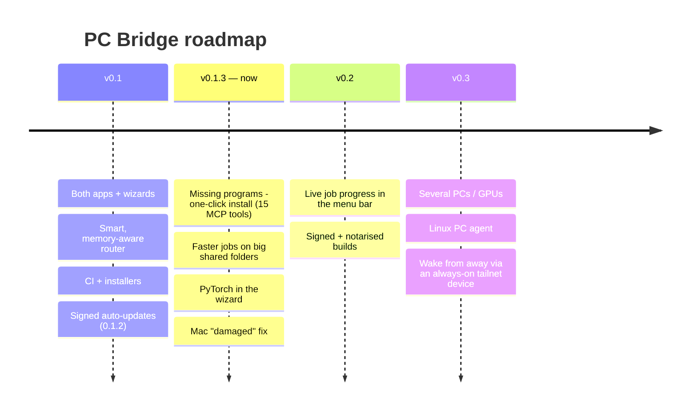

# PC Bridge — Roadmap

> **Living document.** Updated at the end of every phase in the same commit as the work.
> Status keys: ✅ done · 🔄 in progress · ⏳ next · 🧊 later / known limitation

_Last updated: 2026-11-21 — **v0.1.3 released** (missing-program installs, targeted output detection, Mac signing fix); CI green on Linux, macOS and Windows_

## Architecture in one picture

```
 MacBook (brain)                                   Windows PC (muscle)
 ┌──────────────────────────────┐   Tailscale     ┌───────────────────────────────┐
 │ Claude Code / Claude Desktop │   (private,     │ PC Bridge app (tray)          │
 │   └─ MCP: `pc-bridge mcp`    │    encrypted)   │   └─ starts Python agent      │
 │ Shims ~/.pcbridge/bin/ffmpeg │ ──────────────► │ FastAPI agent :8765           │
 │   └─ `pc-bridge shim ffmpeg` │   token auth    │   queue · GPU · claude -p     │
 │ PC Bridge app (menu bar)     │ ◄────────────── │ D:\PCBridge\ (strict root)    │
 │ Syncthing  ◄──── files ────► │                 │ Syncthing                     │
 └──────────────────────────────┘                 └───────────────────────────────┘
```

One Rust binary (`pc-bridge`) = desktop app + MCP server + shim runner. Shared logic lives in
`crates/bridge-core` (pure Rust, unit-tested without a GUI).

## Phases

| # | Phase | Status | Notes |
|---|-------|--------|-------|
| 0 | Repo scaffold, roadmap, architecture | ✅ | |
| 1 | PC agent (FastAPI): /run /delegate /status /gpu /memory /files /cancel /pair, queue, strict root, cache, cleanup | ✅ | 30 tests, ruff clean |
| 2 | `bridge-core` Rust crate: path mapping, **memory-aware** router, GPU/RAM job detection, ffmpeg NVENC rewrite, agent client, MCP server | ✅ | 44 tests, clippy clean |
| 2b | **Memory-aware routing (added 2026-11-21)**: Mac memory pressure, RAM estimates, docker/node/npm/pnpm shims (opt-in per project), generic `pc_run_task`, Mac vs PC RAM side by side, Help text | ✅ | Mac reports its RAM to the PC (`POST /peer/memory`) so both apps show Mac vs PC |
| 3 | Tauri app: wizards (Mac 8 steps / Windows 9 steps), Status/Jobs/Settings/Help, tray/menu bar, diagnostics | ✅ | React + TS, light/dark |
| 4 | Installers & system actions: winget installs, WoL adapter config, power, autostart, keychain, MCP config writers, shims | ✅ | Windows paths verified in CI build only (no Windows box here) |
| 5 | CI (tests + lint, macOS + Windows) and release workflow (DMG + Setup.exe) | ✅ | Windows CI caught 2 path-separator bugs, both fixed |
| 6 | Docs: README, GUIDE.md (beginner), unsigned-app instructions | ✅ | |
| 7 | GitHub repo, first release, CI green | ✅ | Public repo, v0.1.0 release with `PC Bridge.dmg` + `PC Bridge Setup.exe` |
| 8 | **v0.1.2 hardening from the first real run**: signed auto-updates, self-updating PC helper, fresh PATH for jobs, helper starts without Finish, Tailscale kept connected | ✅ | Found by the first real Windows + Mac run |
| 9 | **v0.1.3**: missing programs (catalog, hints, `pc_install`, Settings → Programs), PyTorch in the wizard, targeted output detection, ad-hoc Mac signing + App Translocation self-heal | ✅ | Released; still to confirm on the real PC and Mac (winget codes, Blender folder, UAC prompt, signing in the release build) |

## Detailed checklist

### Phase 1 — PC agent
- [x] Config + strict root resolution (`D:\PCBridge` → fallback `C:\PCBridge`; refuses other paths)
- [x] Pairing: 6-digit code (15 min expiry, 5 attempts, one use) → token
- [x] FIFO job queue, 1 GPU slot, job folders `jobs/YYYY-MM-DD/<id>_<name>/`
- [x] POST /run streamed (NDJSON), exit code passthrough
- [x] POST /delegate (`claude -p … --output-format stream-json` in `worker/`)
- [x] GET /status, GET /gpu (nvidia-smi), POST /jobs/{id}/cancel
- [x] POST /files/push, GET /files/pull (root-confined)
- [x] Result cache (content hash, size cap, LRU)
- [x] Optional command allowlist; 14-day cleanup
- [x] Tests: paths, queue, pairing, cache, GPU parse, end-to-end with mock commands

### Phase 2 — bridge-core
- [x] Mac memory pressure (`memory_pressure` / `vm_stat`) + per-job RAM estimate (pandas/numpy, docker, next build, LLMs)
- [x] Router sends RAM-heavy jobs or jobs during Mac memory pressure to the PC
- [x] Shims + MCP tools for docker, node/npm/pnpm (opt-in per project via `.pcbridge` file) and generic `pc_run_task`
- [x] Path mapping Mac ⇄ PC (shared folders → `workspace\<name>\…`)
- [x] Smart router (Mac est. vs PC est. + transfer + queue; learns from SQLite history)
- [x] Python GPU detection (torch/diffusers/whisper/comfy/marker)
- [x] ffmpeg NVENC auto-swap (libx264→h264_nvenc, libx265→hevc_nvenc when safe)
- [x] HTTP client (streaming), Wake-on-LAN magic packet
- [x] MCP stdio server: pc_run, pc_delegate_task, pc_status, pc_gpu, pc_push_file, pc_pull_file, pc_wake, comfy_generate, ollama_chat
- [x] Tests: mapping, router, detection, ffmpeg rewrite, MCP protocol, mock-agent e2e

- [x] Claude wiring: MCP entries (Claude Code + Desktop), CLAUDE.md block, shims, PATH — idempotent + backups + undo
- [x] Real cross-language e2e (`scripts/e2e-real-agent.sh`)

### Phase 3–4 — App
- [x] Wizard framework (what/why/do-it/check/progress/resume — step saved after every move)
- [x] Windows wizard steps 1–9, Mac wizard steps 1–8
- [x] Status, Jobs, Settings, Help (diagram + FAQ + security), Run diagnostics
- [x] Tray/menu bar icon green/yellow/red with quick menu (pause, wake, open last output)
- [x] Mac vs PC free RAM side by side (both apps; Mac reports its RAM to the PC)
- [x] Help: "apps open on the Mac still use Mac RAM; only jobs sent to the PC use PC RAM"
- [x] Writes Claude Code + Claude Desktop MCP config, CLAUDE.md snippet (preview first)
- [x] Windows: winget installs (Tailscale, FFmpeg, Python, Syncthing, Ollama), Claude Code installer, agent venv, WoL adapter + Fast-startup off (one admin prompt), power plan, autostart
- [x] Per-project opt-in for npm/pnpm/docker explained in Settings

### Phase 5–7 — Ship
- [x] `ci.yml`: agent pytest + ruff (Linux + Windows); Rust fmt + clippy + tests (macOS + Windows); UI lint + tests; real-agent e2e; installer build on both OSes
- [x] `release.yml`: on tag `v*` → `PC Bridge.dmg` (Apple Silicon) + `PC Bridge Setup.exe`
- [x] README (assumptions first), `docs/GUIDE.md` (mirrors both wizards, unsigned-app steps, troubleshooting), LICENSE (MIT)
- [x] Repo created and pushed, CI green
- [x] Open-source docs: README, USAGE, ARCHITECTURE (diagrams), CONTRIBUTING, SECURITY, CODE_OF_CONDUCT, CHANGELOG, issue/PR templates, Dependabot
- [x] Public visibility + tag v0.1.0 → installers on the release page

### Phase 8 — v0.1.2 hardening
- [x] Tauri updater: signed `latest.json` on every release, background check (2 min after start, then every 6 h), Settings → Check for updates; the PC waits for running jobs
- [x] Windows app compares the running helper's version with the bundled one at start, stops an old or orphaned helper (port 8765), reinstalls and restarts it
- [x] Agent looks programs up in the registry's current PATH (+ WinGet Links, `~/.local/bin`) for every job and status
- [x] Helper starts whenever it's installed (not only after the wizard's Finish)
- [x] Tailscale watchdog on both computers (open app / reconnect; never touches sign-in); Windows unattended mode
- [x] Settings → Restart the helper (Windows)
- [x] Output detection off the event loop (scandir in a worker thread, skips `node_modules`/`.git`/Syncthing temp files, mtime ≥ job start); output copy, cache, cleanup and `/status` lookups in threads; test proves `/health` stays fast during a job
- [x] Mac never re-runs a job locally once the PC accepted it (pull failures and dropped streams become warnings)
- [x] Inline code after `-Command`, `-e`, `-c`, `/c` and code-looking arguments are never treated as paths

### Phase 9 — v0.1.3
- [x] Agent catalog of installable programs (`programs.py`): FFmpeg, Blender, PyTorch (GPU, pip cu128: torch + torchvision + torchaudio), Ollama, Node.js LTS, Docker Desktop, Git. Aliases (`torch`, `npm`, `Node.js`…); never arbitrary commands
- [x] Missing-program detection: exit 127, `No module named '…'` (also split across output chunks), shell "not recognized" / "not found" → plain hint on stderr, `missing` event, `missing` in the job summary
- [x] `GET /programs` (catalog + installed + free space + drive) and `POST /programs/install` (404 unknown, 507 low disk = size + 2 GB, 503 no winget/Python; queue job kind `install`; joins a running install; winget "already installed" = success)
- [x] Bare `python` jobs use the PC's own Python (not the agent venv or the Store alias); Blender found in `%ProgramFiles%\Blender Foundation\` when not on PATH
- [x] `pc_install` MCP tool (15 tools), `pc_status` programs line, missing-program note on `pc_run`/`pc_docker`/`pc_node_build` results, CLAUDE.md line, `AgentClient::programs()` / `install_program()`
- [x] Mac never re-runs a job whose program was missing on the PC (tests for forced and routed runs)
- [x] Windows Settings → Programs card (installed / Install, free space, low-space warning, installer log) and "PyTorch (GPU)" in wizard step 6
- [x] Targeted output detection: job folder 2 levels deep (whole folder for `/delegate`), folders named by arguments inside the root (max 32), 5 s budget per scan, nearest first
- [x] Mac release builds signed ad-hoc (`signingIdentity: "-"`); release workflow verifies the app, the update `.tar.gz` and the `.dmg` with `codesign`
- [x] Mac self-heal at start: clear the quarantine mark on `/Applications/PC Bridge.app`, relaunch from Applications when translocated, otherwise ask to move it
- [x] Docs: USAGE, ARCHITECTURE, GUIDE, SECURITY, CHANGELOG (Unreleased)
- [ ] Try on a real PC and Mac before tagging: winget exit codes, Blender's install folder, the Windows "Yes" prompt, the signed `.dmg` on macOS 15

## What's next (after v0.1)



| Version | Item | Why |
|---|---|---|
| ✅ **0.1.3** | **Missing programs: tell Claude and offer a one-click install.** When a job needs a program the PC doesn't have (Blender, PyTorch…), the job result says exactly what's missing and the install command, so Claude can offer it. The PC app shows an **Install Blender** button. Programs go in their normal Windows place, never in the shared folders | Today the job just fails with "program not found" and you have to know what to install |
| ✅ **0.1.3** | **Faster jobs on big shared folders**: look for a job's new files only in the folders it names and its own folder (with a time limit), instead of scanning the whole shared folder | Even tiny jobs take 20–45 s when the shared folder is very large |
| ✅ **0.1.3** | **Optional "PyTorch with GPU support" in the PC wizard** (step 6, next to Ollama and ComfyUI), plus a free-space check on drive C: | The final GPU test needs PyTorch, which the wizard didn't install (found on the first real run) |
| 0.2 | Live progress (percent / ETA) for ffmpeg and ComfyUI jobs in the menu bar | Long encodes currently show only "running" |
| 0.2 | Code signing + notarisation | Removes the "unidentified developer" / SmartScreen steps |
| 0.2 | Send whole project folders for Node/Docker without a separate `npm ci` on the PC | Removes a known limitation |
| 0.3 | Several PCs, choose by free VRAM | Households/studios with more than one GPU box |
| 0.3 | Linux PC agent (same Python agent, systemd unit) | Many GPU boxes run Linux |
| 0.3 | Wake-on-LAN from away, relayed by an always-on device on the tailnet | Today WoL only works on the home network |

## Decisions log
- **2026-11-21** One Rust binary serves app + MCP + shims → no Python/Node needed on the Mac.
- **2026-11-21** Agent streams NDJSON (one JSON object per line) — simple, proxy-safe, easy to test.
- **2026-11-21** Scope addition from user: memory-aware routing (RAM-heavy jobs + Mac memory pressure → PC).
- **2026-11-21** Node/Docker shims are opt-in per project: a `.pcbridge` file in the project with `offload = ["npm","docker"]` — avoids surprising redirection of everyday commands.
- **2026-11-21** Real-agent e2e found that POSIX agent roots (tests, WSL2 mode) need `/` paths and keep `python3`; fixed in `PathMapper`/`plan`.
- **2026-11-21** Both apps show Mac vs PC RAM: the Mac posts its memory to the agent on every status poll (window + tray), the PC app reads it from `/status.peer_memory`.
- **2026-11-21** macOS Tailscale CLI is the app binary; started from a GUI app (no TTY) it tries to open its GUI → always set `TAILSCALE_BE_CLI=1` (found by the first real user run). Added `pc-bridge doctor` to check this without the window.
- **2026-11-21** (v0.1.1) Claude Code's native Windows installer leaves `claude.exe` in `%USERPROFILE%\.local\bin` off PATH → app finds it, adds it to the *user* PATH via the registry (keeps `%VARS%`, no admin), and passes the full path to the agent; the agent also falls back to `~/.local/bin`. Found by the first real Windows run.
- **2026-11-21** Open-sourced under MIT with full contributor docs.
- **2026-11-21** (v0.1.2) A long-running agent's PATH goes stale after winget installs → the agent re-reads PATH from the registry for each job (and resolves the program itself, because Windows ignores the child's PATH when finding the executable). Found when the first test encode failed with code 127.
- **2026-11-21** (v0.1.2) App updates leave the old helper process running → the app checks `/health` version at start and replaces the helper. Auto-update moved forward from 0.2 at the user's request; the update signing key lives in `~/.tauri/` on the maintainer's Mac and in two repo secrets.
- **2026-11-21** (v0.1.2) The agent froze for over a minute per job on a big shared folder (synchronous `rglob` before/after each job, on the event loop) → tray flicker + broken speed test. All disk walks now run in threads, and the GPU slot is held until outputs are collected so jobs never mix files. Found on the first real run with a large shared folder.
- **2026-11-21** (v0.1.2) Tailscale is a hard dependency → both apps keep it open and connected, but never sign in or out for the user.
- **2026-11-21** (v0.1.3) Missing programs: the agent only installs programs from a fixed catalog (`programs.py`), each with its own winget id or pip package list; the request carries just a name, so neither Claude nor the Mac can make the PC run an arbitrary install command. Installs go to normal Windows locations (never the PCBridge or shared folders, so nothing big syncs back), need size + 2 GB free, run as ordinary queue jobs, and Claude must ask the user first. A job whose program is missing is still a PC result (exit 127), never re-run on the Mac.
- **2026-11-21** (v0.1.3) Snapshot targeting: output detection looks only in the job's folder (2 levels) and folders named by its arguments inside the root, with a 5 s budget, instead of walking the whole shared folder (20–45 s per job on big folders). Accepted trade-off: files written elsewhere aren't job outputs or cached, but still reach the Mac through Syncthing if they're in a shared folder.
- **2026-11-21** (v0.1.3) Mac Gatekeeper: 0.1.2 shipped with only the linker's signature, so macOS 15 called it "damaged" and App Translocation ran it from a read-only copy that couldn't update. Fix: ad-hoc signing in the bundler (no paid certificate yet; hardened runtime off because it's only for notarization), a release check with `codesign`, and a self-heal at start that removes the quarantine mark from `/Applications/PC Bridge.app` only (the user has already opened it) and relaunches from there. Found by the first real Mac install of 0.1.2.
- **2026-11-21** Windows app launches the agent as a child process (autostart with Windows) instead of a Windows Service → no admin rights needed day-to-day.

## Known limitations
- Files a job opens **without naming them on the command line** (e.g. a script reading `data.csv` internally) reach the PC only through Syncthing; files named in the command are pushed automatically if missing.
- Output detection looks only in the job's folder (2 levels of sub-folders) and in folders named on the command line, and stops after 200,000 files or 5 seconds. Files a job writes elsewhere aren't listed as outputs or cached; if they're in a shared folder they still reach the Mac through Syncthing.
- `pc_install` covers a fixed list of seven programs. A Windows "Yes" (UAC) prompt on the PC may need someone at the PC. A CPU-only PyTorch, or torch without torchvision, still counts as "installed".
- Wake-on-LAN works only when the Mac is on the same home network as the PC (Tailscale can't carry the wake signal).
- Node/Docker offload needs the project's dependencies installed on the PC side (Windows `node_modules` are not synced from the Mac).
- The apps are **not signed with a paid certificate** (the Mac app is ad-hoc signed from 0.1.3): macOS Gatekeeper and Windows SmartScreen warn on first open (one-time "Open Anyway" / "Run anyway" in `docs/GUIDE.md`). Ad-hoc signatures change with every build, so the Keychain may ask again after an update.
- GitHub stores release files with spaces as dots, so the downloads are named `PC.Bridge.dmg` / `PC.Bridge.Setup.exe` (the release page label shows the readable name).
- The Windows side (winget installs, WoL adapter script, power plan, tray) is compiled and built in CI but was not run on a real Windows PC during development.
- Only an Apple Silicon DMG is produced (no Intel Mac build).
