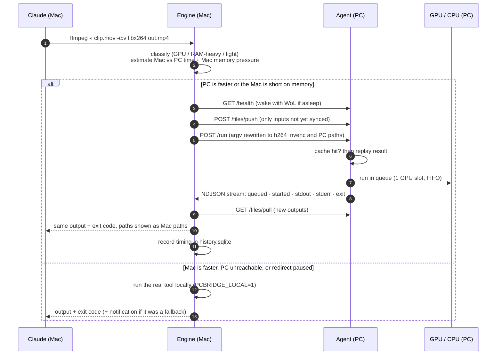
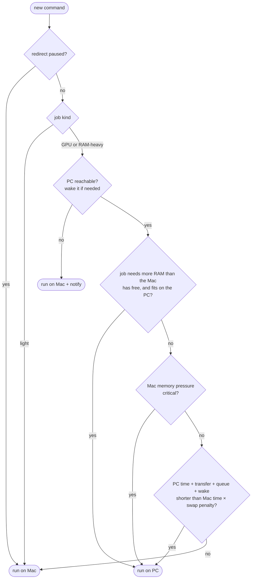
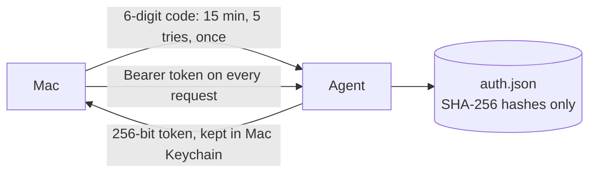

# Architecture

This page shows how the pieces fit together. The diagrams are [Mermaid](https://mermaid.js.org/) and render directly on GitHub.

## System map


### One binary, four modes (Mac)

| Command | Who runs it | Purpose |
|---|---|---|
| `pc-bridge` | You (double-click) | The desktop app: wizard, status, jobs, settings, help, menu bar |
| `pc-bridge mcp` | Claude Code / Claude Desktop | MCP server over stdio that exposes the `pc_*` tools |
| `pc-bridge shim <tool> …` | The shell scripts in `~/.pcbridge/bin` | Transparent redirect: decides Mac or PC, runs, then returns output and exit code |
| `pc-bridge run -- <cmd>` | You or Claude | Forces any command onto the PC |
| `pc-bridge doctor` | You (support) | Prints the health checks as JSON |

On Windows the same binary is the tray app. It also creates a Python virtual environment in `PCBridge\config\venv` and starts the agent from it.

## Life of a job



## Routing decision



* **Transfer time** = 2 × size (MB) × 8 ÷ measured Mbps (inputs up, outputs back).
* **Queue** = jobs waiting × 60 s. **Wake** = 25 s if the PC was asleep.
* **Swap penalty** on the Mac time: ×1.5 when memory pressure is *warn*, ×3 when it is *critical*.
* **Speed-ups** start from defaults (ffmpeg 4×, Blender 5×, ComfyUI 8×, GPU Python 6×, RAM-heavy 1.3×). Once a tool has 3 or more past runs, the median seconds-per-MB of its last 20 runs replaces the default.

### How jobs are classified

| Kind | Examples | How it's detected |
|---|---|---|
| GPU | `ffmpeg` encodes, `blender`, ComfyUI, `python` with torch/diffusers/whisper/… | tool name, ffmpeg arguments, Python imports, `# pcbridge: gpu` marker |
| RAM-heavy | pandas/numpy/polars scripts, `docker`, `next build`, `npm test`, `ollama` with large models | Python imports, opted-in tool + subcommand, model size in the name (e.g. `70b`), `# pcbridge: ram` |
| Light | `git`, `npm install`, small scripts | everything else; `# pcbridge: local` forces it |

## Path mapping

Each shared Mac folder is given a name, and the PC holds it under `workspace\<name>`:

```
/Users/me/Videos/clip.mov   ⇄   workspace/Videos/clip.mov   ⇄   D:\PCBridge\workspace\Videos\clip.mov
```

Command arguments are rewritten on the way in. Paths in the output (stdout and stderr) are rewritten back to Mac paths on the way out. Any path outside the shared folders is refused on the PC.

## PC folder layout

```
D:\PCBridge\
├── workspace\    shared folders (Syncthing) — one sub-folder per Mac folder
├── jobs\         jobs\2026-11-21\<id>_<name>\  (stdout.log, stderr.log, outputs) — deleted after 14 days
├── worker\       scratch space for the worker Claude
├── cache\        result cache (content-hash keyed, LRU, 20 GB cap)
├── models\       Ollama / ComfyUI models (optional)
├── logs\         agent.log, syncthing.log
└── config\       settings.json, auth.json (token hashes), venv\, agent-src\
```

## Security model



* The agent binds only to `127.0.0.1` and the PC's Tailscale IP.
* Every path is resolved and checked against the root. An optional `allowlist` limits which programs can run.
* The PC's own tray app authenticates with a separate local token file that never leaves the PC.

## Code map

| Path | Language | Responsibility |
|---|---|---|
| `agent/pcbridge_agent/app.py` | Python | HTTP API, streaming, Syncthing/Ollama/ComfyUI endpoints |
| `agent/pcbridge_agent/jobs.py` | Python | FIFO queue, process runner, output detection, keep-awake |
| `agent/pcbridge_agent/{pairing,cache,cleanup,gpu,memory,config}.py` | Python | One concern each |
| `crates/bridge-core/src/router.rs` | Rust | Routing decision + SQLite history |
| `crates/bridge-core/src/detect.rs` | Rust | Job classification, RAM estimates, NVENC rewrite, `.pcbridge` opt-ins |
| `crates/bridge-core/src/shim.rs` | Rust | The engine: plan → wake → push → run → pull → record |
| `crates/bridge-core/src/mcp.rs` | Rust | MCP protocol + tool definitions |
| `crates/bridge-core/src/paths.rs` | Rust | Mac ⇄ PC path mapping |
| `crates/bridge-core/src/claude_config.rs` | Rust | Idempotent edits to Claude configs, CLAUDE.md, shims, PATH |
| `app/src-tauri/src/{mac,win,tray}.rs` | Rust | Tauri commands for each OS, tray icon |
| `app/src/` | TypeScript/React | Wizards and the four main screens |
