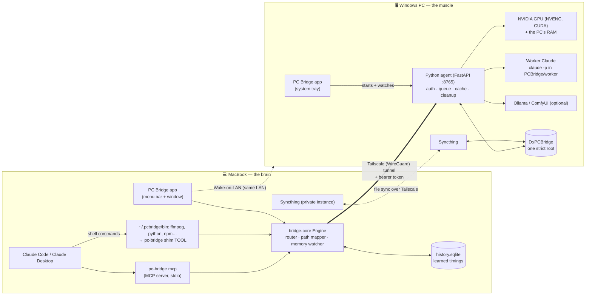
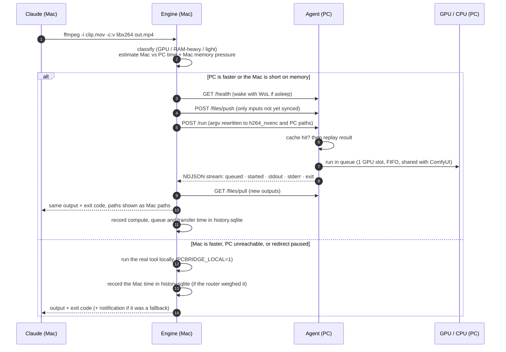
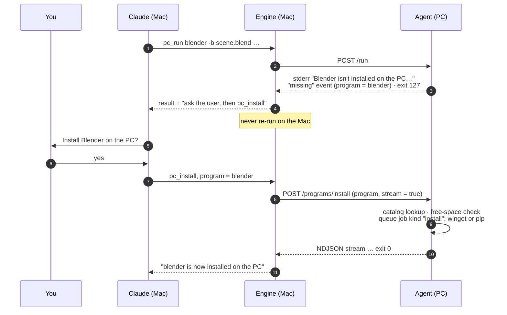
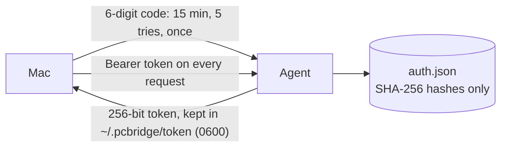

# Architecture

This page shows how the pieces fit together. The diagrams are [Mermaid](https://mermaid.js.org/) and render directly on GitHub.

## System map



### One binary, four modes (Mac)

| Command | Who runs it | Purpose |
|---|---|---|
| `pc-bridge` | You (double-click) | The desktop app: wizard, status, jobs, settings, help, menu bar |
| `pc-bridge mcp` | Claude Code / Claude Desktop | MCP server over stdio that exposes the `pc_*` tools |
| `pc-bridge shim <tool> …` | The shell scripts in `~/.pcbridge/bin` | Transparent redirect: decides Mac or PC, runs, then returns output and exit code |
| `pc-bridge run -- <cmd>` | You or Claude | Forces any command onto the PC |
| `pc-bridge doctor` | You (support) | Prints the health checks as JSON |

On Windows the same binary is the tray app. It also creates a Python virtual environment in `PCBridge\config\venv` and starts the agent from it.

On the Mac, release builds check where they're running from as the very first step (`mac::heal_install_location`):

| Running from | What the app does |
|---|---|
| `/Applications/PC Bridge.app`, still marked "downloaded from the internet" | Removes that mark (`xattr -dr com.apple.quarantine`) from this one bundle and carries on |
| A hidden read-only copy (`…/AppTranslocation/…`) that macOS made, and `/Applications/PC Bridge.app` exists | Removes the mark from `/Applications/PC Bridge.app`, checks it's gone, starts that copy and quits (so the next start isn't translocated and updates can replace the app) |
| A hidden copy with nothing in Applications, or Downloads, the opened `.dmg`… | Shows "PC Bridge needs to be in your Applications folder" with an **Open Applications folder** button |
| Any other copy in `/Applications` or `~/Applications` | Nothing |

Release builds are signed ad-hoc (`bundle.macOS.signingIdentity: "-"` in `tauri.conf.json`), before the `.dmg` and the update `.app.tar.gz` are made. The release workflow runs `codesign --verify --deep --strict` on the built app, the app inside the update file and the app inside the `.dmg`, and fails if any of them only has the compiler's temporary "linker-signed" signature (the cause of 0.1.2's "damaged" message).

## Life of a job



### When a program is missing on the PC



The agent marks a job as "missing a program" when the program can't be started (exit code 127), when stderr shows `No module named '<x>'` for a catalog module (`torch`, `torchvision`, `torchaudio`), or when a shell says a catalog command "is not recognized" / "not found". It adds a plain hint on stderr, a `missing` event, and `"missing": "<key>"` in the job summary. The Mac's `ShimResult` and `JobOutcome` carry it as `missing`.

| Endpoint | What it does | Errors |
|---|---|---|
| `GET /programs` | The catalog with `installed` for each program, plus `free_gb` and `drive` (the Windows drive) | – |
| `POST /programs/install` `{program, stream}` | Looks the name up in the catalog (aliases like `torch`, `npm`, `Node.js` work), checks free space, then runs the catalog's own winget or pip command as a job of kind `install` in `PCBridge\worker`, in its own lane (one install at a time, never holding a GPU slot; no output scan). Streams NDJSON like `/run`. A second request for the same program follows the running install. winget's "already installed" codes count as success; "restart to finish" counts as success with a `restart_needed` event. winget installs are stopped after 20 min without progress, any install after 3 h | 404 not in the catalog · 507 not enough space (needs size + 2 GB) · 503 winget or Python missing |

Both need the token. The catalog lives in `agent/pcbridge_agent/programs.py`. Nothing else can be installed through these endpoints.

### How a job's outputs are found

Before and after each job, the agent takes a snapshot (file → modified time) in a worker thread, then lists files that are new or changed since the job started. The snapshot covers:

* the job's working folder, down to 2 levels of sub-folders (all of it for `/delegate` jobs);
* folders named by the job's arguments, absolute or relative to the working folder, including `key=value` forms, but only inside the PC root and at most 32 of them. A folder argument is scanned 2 levels deep; for a file argument only its parent folder's own files count. Flags and URLs are ignored. Blender's `//renders/f_####` is relative to the job's first `.blend` file (or the working folder without one): that file's folder is scanned 2 levels deep, plus the named folder if it already exists.

Nearest folders go first. A snapshot skips `node_modules`, `.git`, `.venv`… and Syncthing temp files, and stops after 200,000 files or 5 seconds. Files written outside these places aren't job outputs (not copied, not cached), but if they're in a shared folder Syncthing still brings them to the Mac.

## Routing decision


* **Size** is counted as at least 1 MB, both in estimates and when learning rates, so small jobs cost their fixed time.
* **Transfer time** = 2 × size (MB) × 8 ÷ measured Mbps (inputs up, outputs back), or the PC's measured overhead for this job (pushing inputs, waiting for outputs to sync) if that is larger.
* **Queue** = jobs waiting × 60 s. **Wake** = 25 s if the PC was asleep.
* **Swap penalty** on the Mac time: ×1.5 when memory pressure is *warn*, ×3 when it is *critical*.
* **Speed-ups** start from defaults (ffmpeg 4×, Blender 5×, ComfyUI 8×, GPU Python 6×, RAM-heavy 1.3×).

### Learning from history

Every job the router weighed is stored in `history.sqlite`: Mac runs (the router chose the Mac, the PC was out of reach, or the PC refused the job) and PC runs. A PC row keeps the agent's `duration` (compute time only) apart from `queue_secs` and the Mac-measured `transfer_secs`, so the estimate adds queue, transfer and wake exactly once. Each row also has a **signature** such as `python:train.py`, `ffmpeg:libx264`, `blender:render`, `npm:build` or `ollama:llama3`.

* A learned rate is the recency-weighted median (each older run weighs 0.85 of the next) of seconds per MB over the last 20 successful runs. It needs 3 runs.
* **Both sides describe the same jobs.** If either side has 3 runs of this signature, only signature rates are used; a side without them uses the default (the PC's default is the Mac rate ÷ speed-up). Otherwise tool-wide rates are taken over signatures both sides have run, or from one side when the other has nothing for the tool.
* Not learned: failed runs, cache hits, and PC rows from before 0.1.4 (they held the whole round trip). A PC with agent 0.1.3 sends no `queue_secs`; its `duration` also covers collecting outputs, so those rows are marked approximate and only used until 3 exact ones exist.

### How jobs are classified

| Kind | Examples | How it's detected |
|---|---|---|
| GPU | `ffmpeg` encodes, `blender`, ComfyUI, `python` with torch/diffusers/whisper/… | tool name, ffmpeg arguments, Python imports, `# pcbridge: gpu` marker |
| RAM-heavy | pandas/numpy/polars scripts, `docker`, `next build`, `npm test`, `ollama` with large models | Python imports, opted-in tool + subcommand, model size in the name (e.g. `70b`), `# pcbridge: ram` |
| Light | `git`, `npm install`, small scripts | everything else; `# pcbridge: local` forces it |

## Path mapping

Each shared Mac folder is given a name, and the PC holds it under `workspace\<name>`:

```
/Users/me/Videos/clip.mov   ⇄   workspace/Videos/clip.mov   ⇄   D:\PCBridge\workspace\Videos\clip.mov
```

Command arguments are rewritten on the way in. Paths in the output (stdout and stderr) are rewritten back to Mac paths on the way out. Any path outside the shared folders is refused on the PC.

## PC folder layout

```
D:\PCBridge\
├── workspace\    shared folders (Syncthing) — one sub-folder per Mac folder
├── jobs\         jobs\2026-11-21\<id>_<name>\  (stdout.log, stderr.log, outputs) — deleted after 14 days
├── worker\       scratch space for the worker Claude
├── cache\        result cache (content-hash keyed, LRU, 20 GB cap)
├── models\       Ollama / ComfyUI models (optional)
├── logs\         agent.log, syncthing.log
└── config\       settings.json, auth.json (token hashes), venv\, agent-src\
```

## Security model



* The agent binds only to `127.0.0.1` and the PC's Tailscale IP.
* Every path is resolved and checked against the root. An optional `allowlist` limits which programs can run.
* The PC's own tray app authenticates with a separate local token file that never leaves the PC.

## Code map

| Path | Language | Responsibility |
|---|---|---|
| `agent/pcbridge_agent/app.py` | Python | HTTP API, streaming, Syncthing/Ollama/ComfyUI endpoints |
| `agent/pcbridge_agent/jobs.py` | Python | FIFO queue, process runner, output detection, missing-program detection, keep-awake |
| `agent/pcbridge_agent/programs.py` | Python | Catalog of installable programs, install commands (winget/pip), missing-program hints, PC Python and Blender lookup |
| `agent/pcbridge_agent/{pairing,cache,cleanup,gpu,memory,config}.py` | Python | One concern each |
| `crates/bridge-core/src/router.rs` | Rust | Routing decision + SQLite history |
| `crates/bridge-core/src/detect.rs` | Rust | Job classification, RAM estimates, NVENC rewrite, `.pcbridge` opt-ins |
| `crates/bridge-core/src/shim.rs` | Rust | The engine: plan → wake → push → run → pull → record |
| `crates/bridge-core/src/mcp.rs` | Rust | MCP protocol + tool definitions |
| `crates/bridge-core/src/paths.rs` | Rust | Mac ⇄ PC path mapping |
| `crates/bridge-core/src/claude_config.rs` | Rust | Idempotent edits to Claude configs, CLAUDE.md, shims, PATH |
| `app/src-tauri/src/{mac,win,tray}.rs` | Rust | Tauri commands for each OS, tray icon. `mac.rs` also keeps the app in Applications; `win.rs` has `win_programs` / `win_install_program` for the Programs card |
| `app/src/` | TypeScript/React | Wizards and the four main screens |
| `app/src/components/Programs.tsx` | TypeScript/React | Windows Settings → Programs card and the wizard's PyTorch option |
